# 🎮 Simulacro Examen 2026


Escribe un programa que poida crear, modificar, ler e eliminar rexistros nas táboas de datos xeradas a través do seguinte script SQL.

---

## 🗄️ Script de Creación de Táboas

```sql
DROP TABLE IF EXISTS InventarioTenda;
DROP TABLE IF EXISTS Videoxogo;

CREATE TABLE Videoxogo (
    Id SERIAL PRIMARY KEY,
    Titulo VARCHAR(255) NOT NULL,
    Plataforma VARCHAR(255),
    AnoLanzamento INT,
    Descripcion VARCHAR(255)
);

CREATE TABLE InventarioTenda (
    Id SERIAL PRIMARY KEY,
    IdVideoxogo INTEGER,
    PrezoMayorista DECIMAL(10, 2),
    PrezoVenta DECIMAL(10, 2),
    PorcentaxeOferta INT,
    FOREIGN KEY (IdVideoxogo) REFERENCES Videoxogo(Id)
);
```

---

## 📋 Requisitos do Programa

1. Escribe unha función que permita serializar nun ficheiro o contido da táboa **Videoxogo**.

   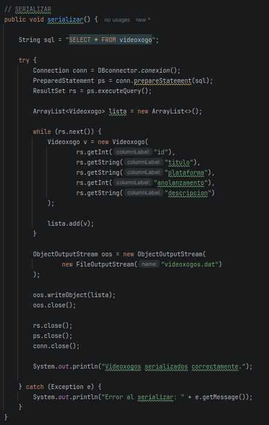

2. Escribe unha función que permita deserializar as entradas do ficheiro creado anteriormente.

   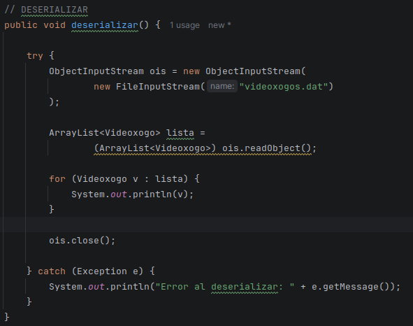

3. Escribe unha función que permita exportar en XML as entradas da táboa **Videoxogo**.

   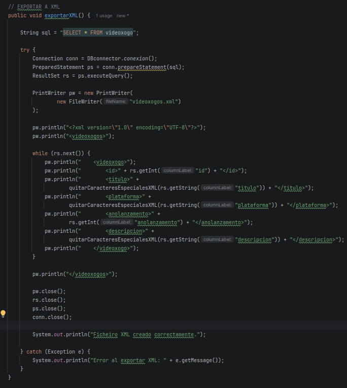

---

## 🚀 Secuencia de Execución

Usando as funcións anteriores, fai que o teu programa execute a seguinte secuencia:

### 1. Inserción de videoxogos
Insertar na táboa **Videoxogo** os seguintes videoxogos *(recorda que os valores da PK son autoxerados)*:

* **The Legend of Zelda: Ocarina of Time** *(Nintendo 64, 1998)*  
  *Descrición:* Clásico xogo de aventura e acción 3D en Hyrule.
* **Elden Ring** *(Multiplataforma, 2022)*  
  *Descrición:* RPG de acción desafiante nun mundo de fantasía escura.
* **The Witcher 3: Wild Hunt** *(Multiplataforma, 2015)*  
  *Descrición:* RPG de fantasía seguindo as aventuras do bruxo Geralt.
* **Bloodborne** *(PlayStation 4, 2015)*  
  *Descrición:* RPG de acción e terror gótico ambientado na cidade de Yharnam.
* **Super Mario Odyssey** *(Nintendo Switch, 2017)*  
  *Descrición:* Plataformas 3D con mecánicas de posesión de obxectos.

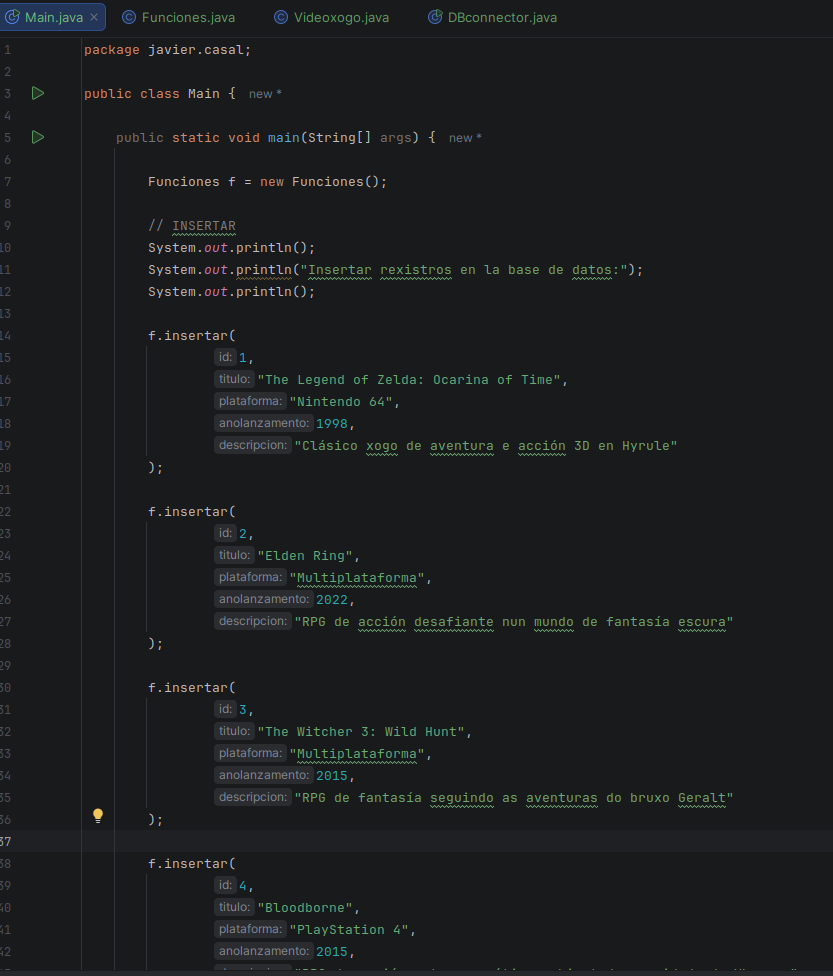
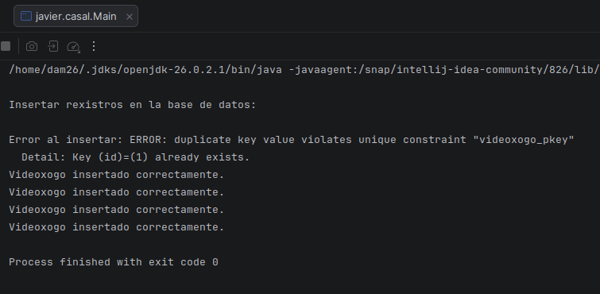
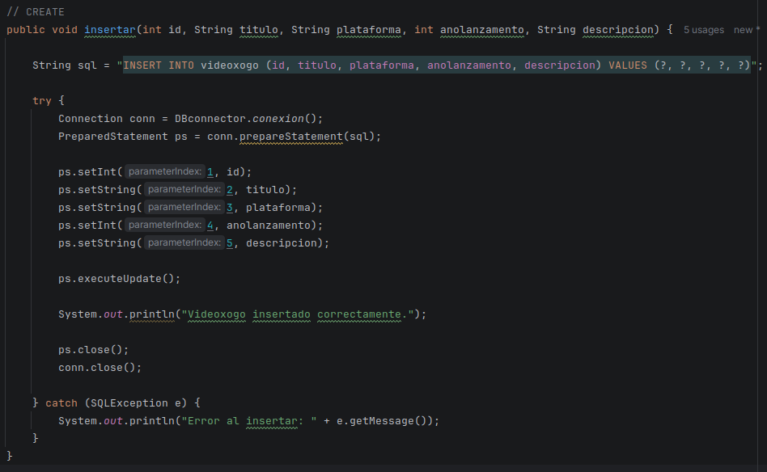

---

### 2. Consulta de IDs
Consulta os IDs que teñen os videoxogos e lístaos.

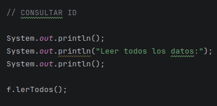
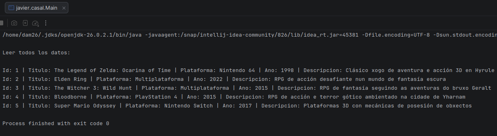
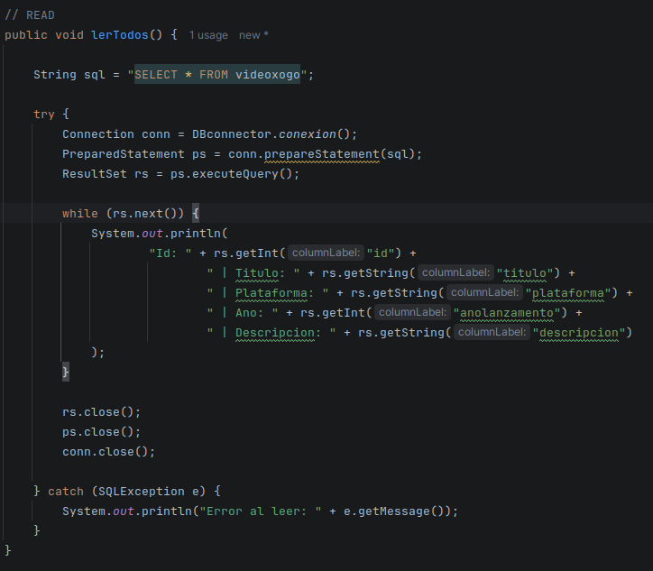

---

### 3. Inserción en Inventario
Inserta na táboa **InventarioTenda** as seguintes entradas:

| Videoxogo (FK) | Prezo Mayorista | Prezo Venta | Porcentaxe Oferta |
| :--- | :---: | :---: | :---: |
| *(Id de The Legend of Zelda: Ocarina of Time)* | 45.00 | 69.99 | 10 |
| *(Id de Elden Ring)* | 40.00 | 59.99 | 12 |
| *(Id de The Witcher 3)* | 15.00 | 29.99 | 5 |
| *(Id de Bloodborne)* | 20.00 | 39.99 | 8 |
| *(Id de Super Mario Odyssey)* | 35.00 | 49.99 | 6 |

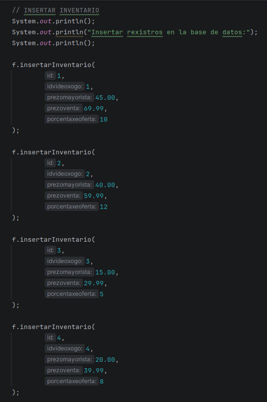
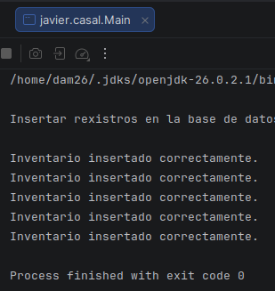
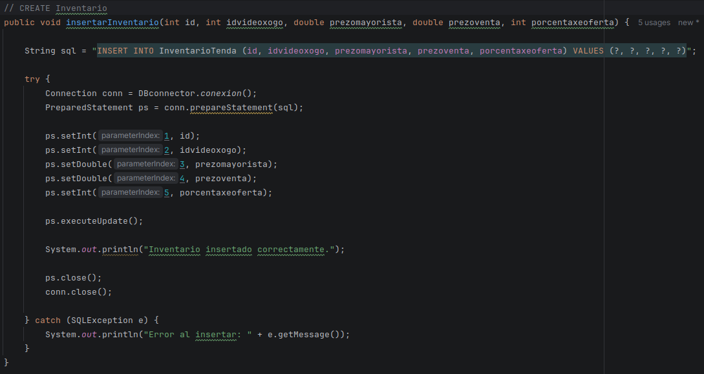

---

### 4. Exportación a XML
Exporta as entradas da táboa **Videoxogo** a XML.

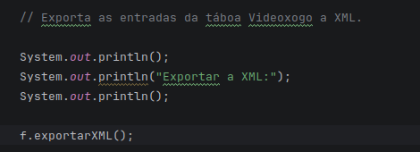
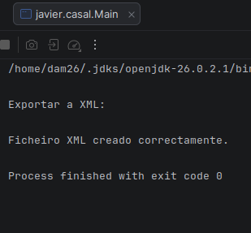

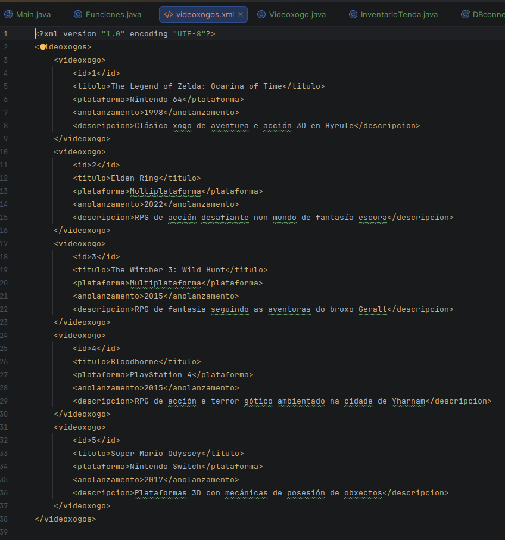

---

### 5. Exportación a Ficheiro
Exporta as entradas da táboa **Videoxogo** nun ficheiro.

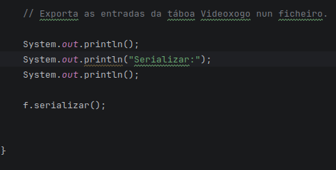
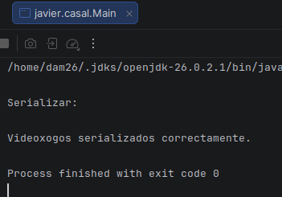

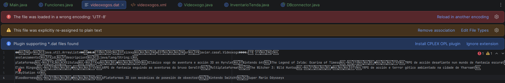

---

### 6. Mensaxe de Ofertas
Mostra unha mensaxe que poña **“OFERTAS VIDEOXOGOS”**.

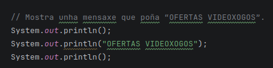
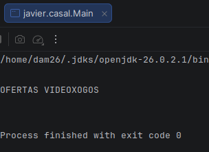

---

### 7. Modificación de Oferta
Modifica a porcentaxe de oferta dos videoxogos en **InventarioTenda** para sumarlle 15.

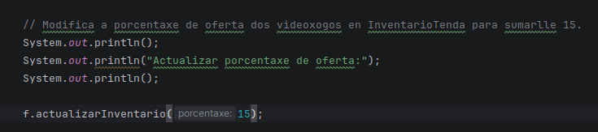
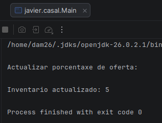
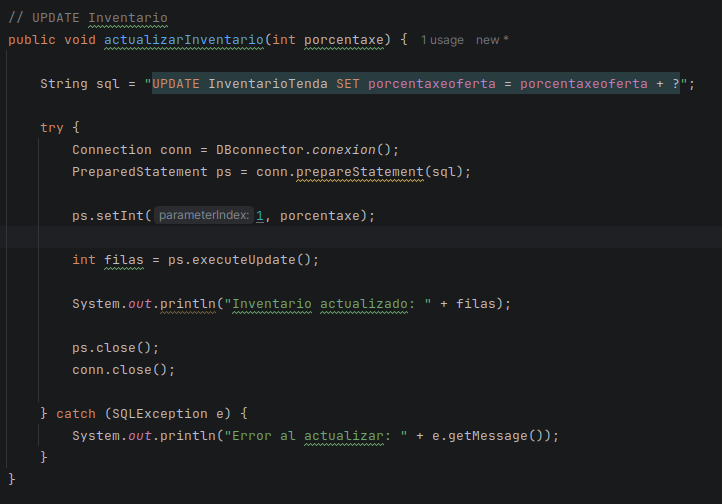

---

### 8. Cálculo do Prezo Actual
Lista o prezo actual de venda de *The Legend of Zelda: Ocarina of Time* (aplicando `PorcentaxeOferta` sobre `PrezoVenta`).

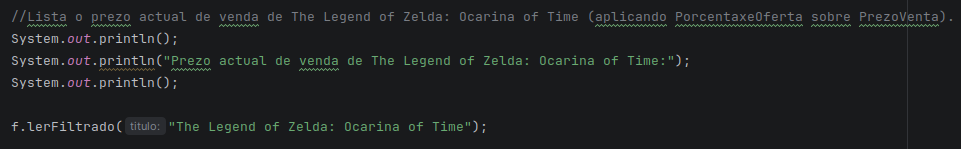
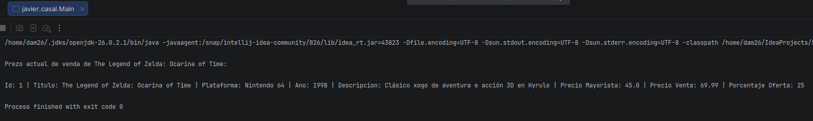
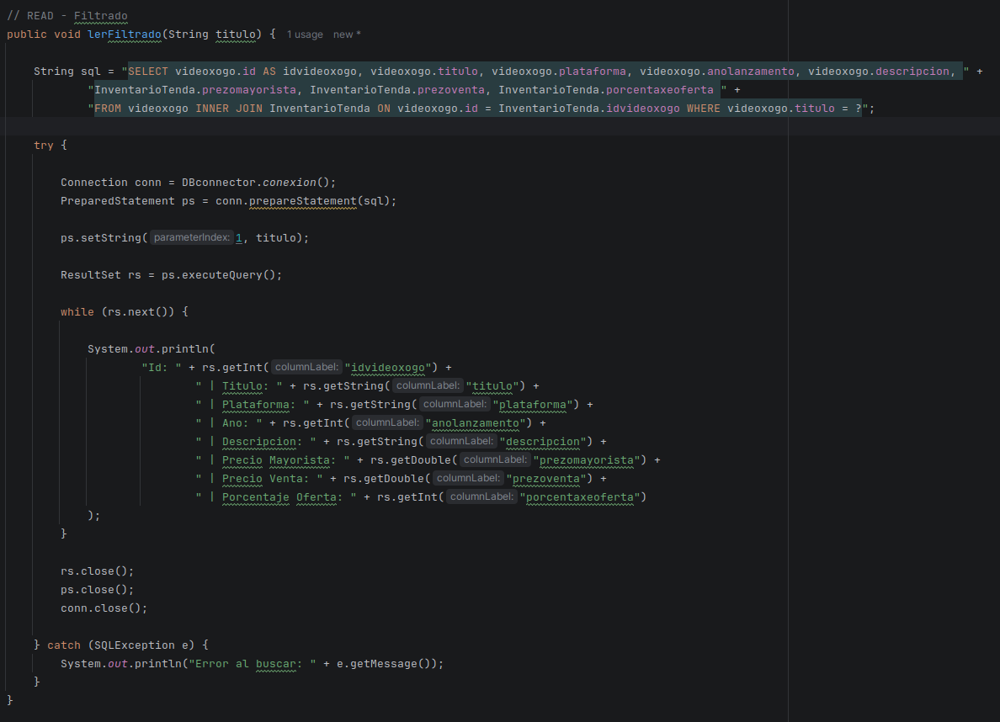

---

### 9. Lectura do Ficheiro Serializado
Lee as entradas de videoxogo do ficheiro serializado.

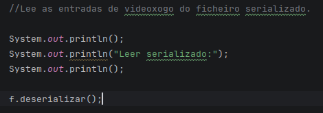
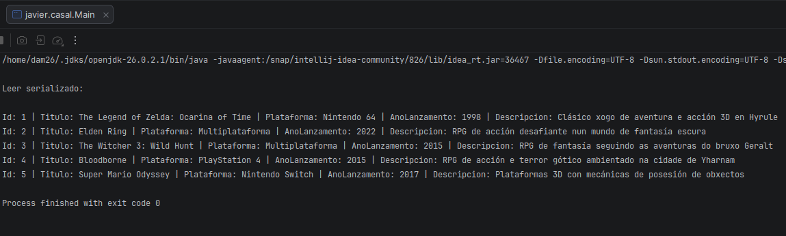


---

### 10. Escritura Final en Texto
Escribe nun ficheiro de texto o lido do ficheiro serializado.

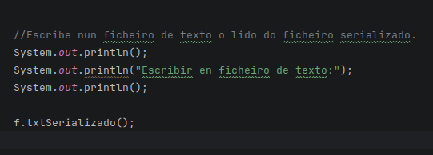
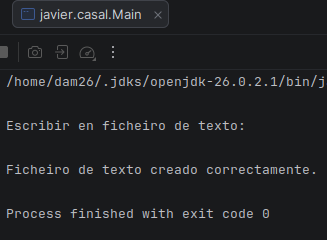
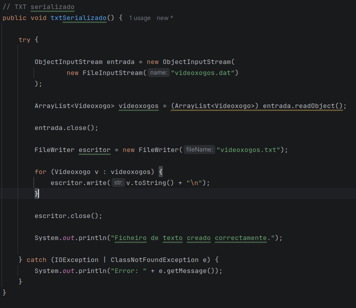
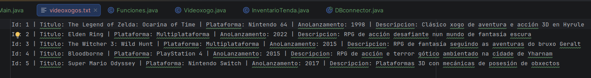